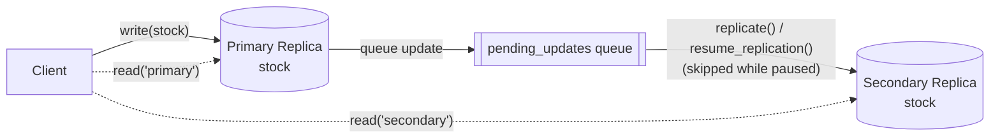
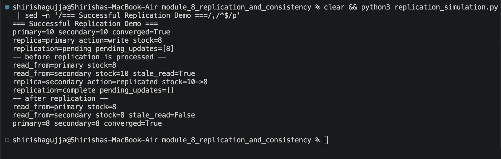
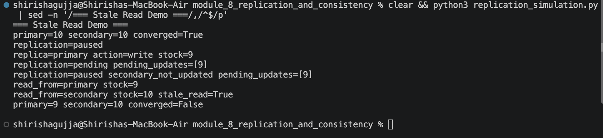
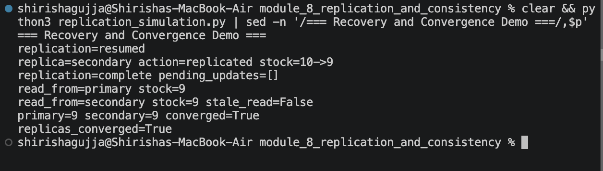
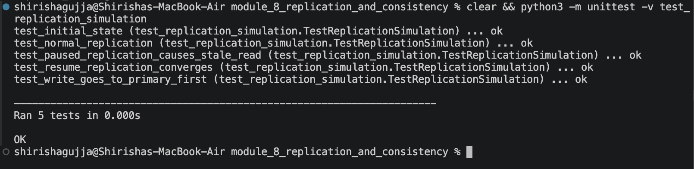

# CMPE 273 – Module 8: Replication & Consistency

## 1. Overview

This project is a small, in-memory **simulation** of a replicated inventory (`stock`, starting at `10`):

- **One Primary replica.** It accepts every write and holds the authoritative value.
- **One Secondary replica.** It keeps its own separate copy of `stock` and gets updates only through replication.
- **Writes go to the Primary first.** Each write is then added to a `pending_updates` queue to be copied to the Secondary.
- **The Secondary receives replicated updates** when replication runs and isn't paused.
- **The client can read from either replica** with `client.read("primary")` or `client.read("secondary")`.
- **Replication can lag.** If replication is paused, the Primary keeps accepting writes, the Secondary falls behind, and reads from it become **stale**. When replication resumes, the pending updates are applied and the replicas **converge**.

There is no network, database, or threading. Everything is plain Python objects, so the output is the same on every run.

## 2. Architecture Diagram



Plain-text version:

```text
            Write
Client --------------> Primary Replica
  |                         |
  |                         | Replication (via pending_updates;
  |                         v  held while paused)
  |                   Secondary Replica
  |
  +---- Read Primary
  |
  +---- Read Secondary
```

## 3. Running Instructions

Requires Python 3 (tested with Python 3.9.6). It uses only the standard library, so there is nothing to install and no virtual environment is needed.

```bash
python3 replication_simulation.py
```

Optional unit tests (built-in `unittest`):

```bash
python3 -m unittest -v test_replication_simulation
```

### Files

| File | Purpose |
|------|---------|
| `replication_simulation.py` | `Replica`, `ReplicatedInventory` (Primary, Secondary, pending queue, pause/resume), `Client`, and the three demos |
| `test_replication_simulation.py` | Unit tests for initial state, write order, replication, stale reads, and convergence |
| `requirements.txt` | Empty except for a comment (standard library only) |
| `.gitignore` | Ignores Python cache files |
| `screenshots/` | Real terminal screenshots used as evidence |

## 4. Successful Replication Evidence

The program starts from `Primary = 10, Secondary = 10` and writes `stock = 8` to the Primary. The Primary changes right away. The Secondary keeps its previous value (`10`) until replication is processed, then becomes `8`.

**Screenshot:**



Actual output from `python3 replication_simulation.py`:

```text
=== Successful Replication Demo ===
primary=10 secondary=10 converged=True
replica=primary action=write stock=8
replication=pending pending_updates=[8]
-- before replication is processed --
read_from=primary stock=8
read_from=secondary stock=10 stale_read=True
replica=secondary action=replicated stock=10->8
replication=complete pending_updates=[]
-- after replication --
read_from=primary stock=8
read_from=secondary stock=8 stale_read=False
primary=8 secondary=8 converged=True
```

1. The Primary receives `8` (`replica=primary action=write stock=8`).
2. Replication runs (`replica=secondary action=replicated stock=10->8`).
3. The Secondary now holds `8`.
4. Both reads return `8`, and `converged=True`.

## 5. Stale-Read Evidence

This demo starts from a fresh state (`Primary = 10, Secondary = 10`). Replication is **paused**, then the Primary is updated to `9`. The program tries to replicate while paused, but the Secondary is not updated and the update stays in `pending_updates`. Then the client reads from both replicas.

**Screenshot:**



Actual output:

```text
=== Stale Read Demo ===
primary=10 secondary=10 converged=True
replication=paused
replica=primary action=write stock=9
replication=pending pending_updates=[9]
replication=paused secondary_not_updated pending_updates=[9]
read_from=primary stock=9
read_from=secondary stock=10 stale_read=True
primary=9 secondary=10 converged=False
```

| Step | Primary | Secondary |
|------|---------|-----------|
| Initial | 10 | 10 |
| Replication paused | 10 | 10 |
| Update Primary to 9 | **9** | 10 |
| Read Primary | **9** | – |
| Read Secondary | – | **10 ← stale read** |

**Why `Secondary = 10` is a stale read:** the newest value is already `9` on the Primary, but replication is paused, so the update `9` is still waiting in `pending_updates`. The Secondary returns `10`, which was the correct value a moment ago. The data is **valid historical data, not corrupted data**. It simply isn't the latest state yet.

## 6. Recovery and Convergence Evidence

After the stale read is printed, replication is **resumed**. The pending update `9` is applied to the Secondary, which changes from `10` to `9`.

**Screenshot:**



Actual output:

```text
=== Recovery and Convergence Demo ===
replication=resumed
replica=secondary action=replicated stock=10->9
replication=complete pending_updates=[]
read_from=primary stock=9
read_from=secondary stock=9 stale_read=False
primary=9 secondary=9 converged=True
replicas_converged=True
```

- Replication resumed (`replication=resumed`).
- The Secondary receives `9` (`stock=10->9`), and the pending queue is now empty.
- Primary = `9` and Secondary = `9`.
- **The replicas have converged again** (`replicas_converged=True`).

## 7. Evidence (Screenshots and Terminal Output)

Each section above includes a real screenshot of a terminal run plus the same output as copyable text. Each screenshot command runs the full program and uses `sed` to display only that demo's section. The simulation has no randomness or timing, so every run prints the same output.

| Screenshot | Command |
|---|---|
| `screenshots/1_successful_replication.png` | `python3 replication_simulation.py \| sed -n '/=== Successful Replication Demo ===/,/^$/p'` |
| `screenshots/2_stale_read.png` | `python3 replication_simulation.py \| sed -n '/=== Stale Read Demo ===/,/^$/p'` |
| `screenshots/3_recovery_convergence.png` | `python3 replication_simulation.py \| sed -n '/=== Recovery and Convergence Demo ===/,$p'` |
| `screenshots/4_unit_tests.png` | `python3 -m unittest -v test_replication_simulation` |

**Unit tests screenshot:**



Unit test output:

```text
$ python3 -m unittest -v test_replication_simulation
test_initial_state (test_replication_simulation.TestReplicationSimulation) ... ok
test_normal_replication (test_replication_simulation.TestReplicationSimulation) ... ok
test_paused_replication_causes_stale_read (test_replication_simulation.TestReplicationSimulation) ... ok
test_resume_replication_converges (test_replication_simulation.TestReplicationSimulation) ... ok
test_write_goes_to_primary_first (test_replication_simulation.TestReplicationSimulation) ... ok

----------------------------------------------------------------------
Ran 5 tests in 0.000s

OK
```

## Reflection

**What tradeoff exists between reading quickly from a replica and guaranteeing that the reader sees the latest value?**

Reading from a replica like the Secondary is fast and takes load off the Primary, but the replica may be lagging behind, so the reader can get stale data. In this simulation, the client read `10` from the Secondary even though the Primary already had `9`. To guarantee the latest value, you have to read from the Primary or wait until replication has caught up. Both options add latency or coordination cost and put more load on the Primary. So the tradeoff is speed and availability versus freshness, and the right choice depends on how much stale data the application can tolerate.
